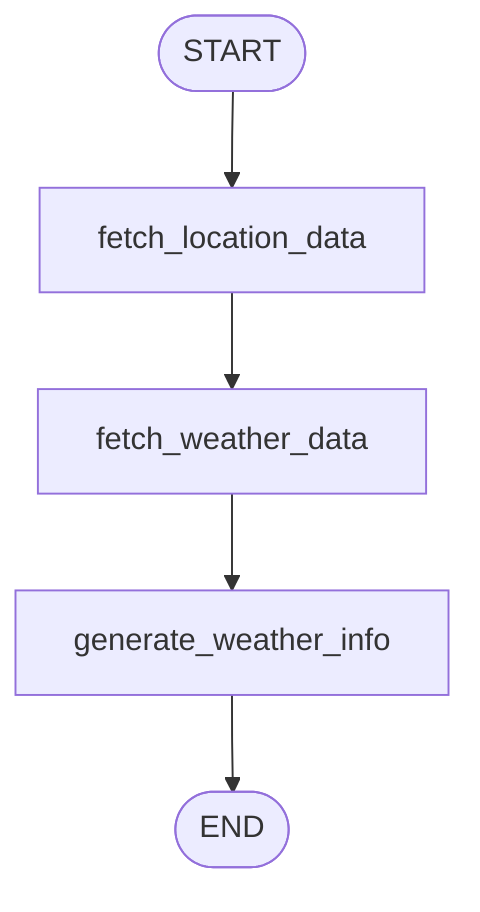
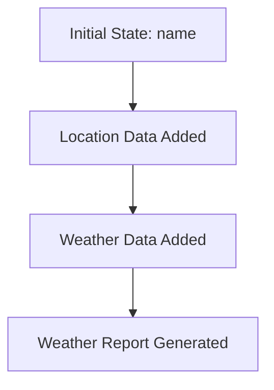

# Assignment 1 — Weather Agent Debugging

## 1. Project Overview

This project is part of the Springer Capital Data Analysis & LLM Training program, specifically the LLM Final Assessment.

The objective of this assignment is to analyze, debug, correct, and validate an existing weather agent built using LangGraph and Python.

The Weather Agent is designed to retrieve the user's approximate geographical location based on their IP address, obtain current weather conditions through an external API, and generate a personalized weather report.

The debugging process followed a structured technical methodology, including static code analysis, error reproduction, root cause analysis, bug fixing, dependency management, and functional validation.

The original architectural approach was preserved while implementing corrections and technical improvements aimed at increasing reliability, data accuracy, code readability, and maintainability.

The corrected workflow passed 40 manually evaluated functional checks and three automated integration tests containing 25 assertions and mock verification checks. These tests use controlled HTTP responses. Live end-to-end validation remains blocked by IPAPI HTTP 429.

---

## 2. Objectives

The main objectives of this assignment are:

- Understand the architecture and execution flow of a LangGraph-based agent.
- Identify and analyze runtime errors, logical bugs, and configuration issues.
- Determine the root causes of the identified problems.
- Implement corrections while preserving the original project architecture.
- Improve data consistency, error handling, and timezone management.
- Validate dependencies, configuration settings, and graph connectivity.
- Perform individual functional tests, automated integration tests with mocked HTTP responses, and live end-to-end validation where external service availability permits.
- Document the debugging process, implemented solutions, test results, and remaining limitations.

---

## 3. Technology Stack

### Programming Language and Development Environment

| Technology | Version / Description |
| --- | --- |
| Python | 3.12.9 |
| Visual Studio Code | Integrated Development Environment |
| Git | 2.56.1 |
| GitHub | Version control and project repository |
| Windows | Development operating system |
| Python Virtual Environment | Dependency isolation |

### Python Dependencies

| Library | Version | Purpose |
| --- | --- | --- |
| langchain | 0.3.26 | LangChain framework |
| langchain-core | 0.3.75 | Core LangChain abstractions |
| langgraph | 0.6.4 | Stateful workflow orchestration |
| pydantic | 2.11.5 | Data modeling and validation |
| pydantic-settings | 2.10.1 | Configuration management |
| requests | 2.34.2 | HTTP requests to external APIs |
| python-dotenv | 1.2.4 | Environment variable management |

### External APIs

| API | Purpose |
| --- | --- |
| IPAPI | IP-based geographical location retrieval |
| Open-Meteo | Current weather information retrieval |

### Python Standard Library

- datetime
- typing
- unittest
- unittest.mock
- pathlib
- sys

The project uses LangGraph to orchestrate a deterministic, stateful workflow. The current implementation does not require an LLM invocation to generate the weather report.

---

## 4. Project Structure

```text
langgraph-assessment/
│
├── README.md
├── .gitignore
│
├── assignment_1/
│   ├── README.md
│   ├── weather_agent_debug.ipynb
│   │
│   ├── tests/
│   │   └── test_weather_agent.py
│   │
│   └── weather_agent/
│       ├── main.py
│       ├── graph.py
│       ├── requirements.txt
│       │
│       └── components/
│           ├── config.py
│           ├── helper_functions.py
│           ├── nodes.py
│           ├── schema.py
│           └── state.py
│
└── assignment_2/
```

### File Responsibilities

| File | Responsibility |
| --- | --- |
| main.py | Application entry point, user input, graph invocation, and result presentation |
| graph.py | LangGraph workflow definition, node registration, edge configuration, and compilation |
| config.py | API endpoints, request settings, temperature thresholds, and weather code mappings |
| helper_functions.py | Temperature classification, weather descriptions, greetings, and timezone conversion |
| nodes.py | Location retrieval, weather retrieval, and personalized report generation |
| schema.py | Pydantic models describing location and weather data structures |
| state.py | Shared state definition used throughout the LangGraph workflow |
| requirements.txt | Explicit project dependency declarations |
| README.md | Technical documentation |
| tests/test_weather_agent.py | Automated graph integration tests using mocked HTTP responses |
| weather_agent_debug.ipynb | Reproducible debugging and validation notebook |

The Pydantic models in `schema.py` describe the expected data structures. The current workflow performs manual field-presence validation in `nodes.py` rather than directly invoking these models.

---

## 5. Agent Architecture

### Workflow Overview

The Weather Agent implements a sequential LangGraph workflow consisting of three functional nodes.

Each node performs a specific responsibility and updates the shared agent state.



#### Node Responsibilities

#### Node 1 — fetch_location_data

**Responsibilities:**

- Send an HTTP request to the IPAPI service.
- Retrieve approximate geographical information based on the outgoing IP address.
- Validate the presence of required location fields.
- Store the retrieved information in the shared agent state.

**Output:**

`location_data`

#### Node 2 — fetch_weather_data

**Responsibilities:**

- Retrieve geographical coordinates from the shared state.
- Construct the Open-Meteo API request.
- Request current weather information using GMT as the reference timezone.
- Validate the presence of required meteorological fields.
- Store the weather information in the shared agent state.

**Output:**

`weather_data`

#### Node 3 — generate_weather_info

**Responsibilities:**

- Retrieve location and meteorological information.
- Generate a personalized greeting.
- Classify the current temperature.
- Translate WMO weather codes into readable descriptions.
- Convert UTC time into local time.
- Construct the final formatted weather report.

**Output:**

`weather_info`

### Shared Agent State

The workflow uses a TypedDict-based state schema named `WeatherAgentState`.

| State Field | Data Type | Responsibility |
| --- | --- | --- |
| name | str | User's name |
| location_data | Optional dictionary | Geographical information |
| weather_data | Optional dictionary | Meteorological information |
| weather_info | Optional string | Final formatted weather report |

### State Evolution



The graph was explicitly compiled using:

```python
weather_agent = builder.compile()
```

Graph compilation and connectivity were successfully verified during the validation phase.

---

## 6. Debugging Methodology

The debugging process followed a structured methodology to identify root causes rather than applying isolated corrections without understanding their impact.

### Phase 1 — Environment Setup

- Install and configure Git.
- Create the GitHub repository.
- Clone the repository into the local development environment.
- Preserve the original source code separately.
- Create an isolated Python virtual environment.
- Install the original project dependencies.
- Validate dependency compatibility.

### Phase 2 — Static Code Analysis

- Review individual source files.
- Analyze module responsibilities.
- Examine imports and dependencies.
- Understand the shared state schema.
- Identify logical errors and configuration inconsistencies.
- Analyze graph connectivity and node execution order.

### Phase 3 — Error Reproduction

Execute the original application and reproduce runtime errors whenever possible.

The execution process exposed several issues, including:

- Pydantic configuration initialization errors.
- Failure to execute the main application function.
- Missing graph compilation.
- External API request limitations.

### Phase 4 — Root Cause Analysis

Determine why each identified issue occurred and analyze its impact on the application.

### Phase 5 — Bug Fixing

Implement targeted corrections while maintaining the original architectural approach.

### Phase 6 — Testing and Validation

**Perform:**

- Dependency validation.
- Configuration validation.
- Individual functional tests.
- Graph compilation and connectivity validation.
- Live end-to-end execution attempts.
- Automated integration testing using `unittest` and `unittest.mock` for successful execution, HTTP 429 handling, and custom wind units.
- Static import resolution in VS Code using local Pylance settings.

### Phase 7 — Technical Documentation

**Document:**

- Identified bugs.
- Root causes.
- Implemented corrections.
- Technical improvements.
- Validation evidence.
- Remaining limitations.

---

## 7. Bug Fixes

Eight primary bugs were identified and addressed during the debugging process.

### BUG-001 — Incorrect Application Entry Point

**File:** main.py

**Category:** Application Execution

**Original Code:**

```python
if __name__ == "_main_":
    main()
```

**Root Cause:**

The Python execution guard contained an incorrect string literal. Python assigns `__main__` to the `__name__` variable when a module is executed directly.

Consequently, the application failed to invoke its main function after successful module initialization.

**Correction:**

```python
if __name__ == "__main__":
    main()
```

**Impact:**

The application now executes its main function when launched directly.

**Validation Status:** Verified through application execution.

---

### BUG-002 — Disconnected Weather Retrieval Node

**File:** graph.py

**Category:** Workflow Architecture

**Original Code:**

```python
builder.add_edge(START, "fetch_location_data")
builder.add_edge("fetch_location_data", "generate_weather_info")
builder.add_edge("generate_weather_info", END)
```

**Root Cause:**

The `fetch_weather_data` node was registered but was not connected to the execution path.

The report generation node could therefore be reached without first retrieving meteorological information.

**Correction:**

```python
builder.add_edge(START, "fetch_location_data")
builder.add_edge("fetch_location_data", "fetch_weather_data")
builder.add_edge("fetch_weather_data", "generate_weather_info")
builder.add_edge("generate_weather_info", END)
```

**Impact:**

The workflow now follows the required sequential data dependencies.

**Validation Status:** Graph connectivity verified through LangGraph introspection.

---

### BUG-003 — Missing Graph Compilation

**File:** graph.py

**Category:** LangGraph Execution

**Original Code:**

```python
weather_agent = builder
```

**Root Cause:**

The StateGraph builder was assigned directly to the application variable without compiling the graph.

The uncompiled builder did not provide the required `invoke()` method.

**Observed Error:**

```text
'StateGraph' object has no attribute 'invoke'
```

**Correction:**

```python
weather_agent = builder.compile()
```

**Impact:**

The application now uses a compiled executable LangGraph workflow.

**Validation Status:** Verified through application execution and graph inspection.

---

### BUG-004 — Incorrect Weather API Endpoint

**File:** components/config.py

**Category:** Configuration Management

**Original Code:**

```python
WEATHER_API_BASE_URL: str = ""
```

**Root Cause:**

A duplicate declaration replaced the correct Open-Meteo endpoint with an empty string.

This would prevent the application from constructing a valid weather API request when using the default configuration.

**Correction:**

Remove the duplicate declaration and retain the correct endpoint:

```python
WEATHER_API_BASE_URL: str = "https://api.open-meteo.com/v1/forecast"
```

**Impact:**

The configuration now provides a valid weather API endpoint.

**Validation Status:** Effective configuration value verified at runtime.

---

### BUG-005 — Invalid Pydantic Configuration Attribute

**File:** components/config.py

**Category:** Configuration Initialization

**Original Code:**

```python
TEMP_MIN = str = "Needs Debugging"
```

**Root Cause:**

The declaration used chained assignment instead of a valid type annotation.

Pydantic requires model fields to contain appropriate type annotations.

**Observed Error:**

```text
pydantic.errors.PydanticUserError:
A non-annotated attribute was detected
```

**Correction:**

Remove the invalid and unnecessary `TEMP_MIN` declaration and eliminate its corresponding reference from the temperature classification function.

**Impact:**

Pydantic Settings can now initialize the application configuration correctly.

**Validation Status:** Verified through successful configuration initialization and subsequent application execution.

---

### BUG-006 — Incorrect Temperature Classification

**File:** components/helper_functions.py

**Category:** Business Logic

**Original Code:**

```python
if temp_celsius:
    return config.TEMP_MIN
```

**Root Cause:**

The conditional statement evaluated the truthiness of the temperature instead of comparing it against the configured temperature thresholds.

Almost every non-zero temperature would enter the first conditional branch, bypassing the intended classification logic.

**Correction:**

```python
def classify_temperature(temp_celsius: float) -> str:
    if temp_celsius < config.TEMP_COLD:
        return "cold"
    elif temp_celsius < config.TEMP_COOL:
        return "cool"
    elif temp_celsius < config.TEMP_COMFORTABLE:
        return "comfortable"
    elif temp_celsius < config.TEMP_WARM:
        return "warm"
    else:
        return "hot"
```

**Impact:**

Temperatures are now classified according to the configured thresholds.

**Validation Status:** 11 out of 11 functional test cases passed.

---

### BUG-007 — Location Data Not Stored in Agent State

**File:** components/nodes.py

**Category:** State Management

**Original Code:**

```python
state["location_data"] = {}
```

**Root Cause:**

The retrieved geographical information was discarded and replaced with an empty dictionary.

Consequently, subsequent nodes would not have access to the required geographical coordinates and location information.

**Correction:**

```python
state["location_data"] = location_data
```

**Impact:**

The corrected code preserves the retrieved location information in the shared agent state.

**Validation Status:** Verified through automated integration testing with mocked HTTP responses: location data is preserved and its coordinates are passed to the weather request. Live verification remains blocked by HTTP 429.

---

### BUG-008 — Incorrect Wind Speed Unit Formatting

**File:** components/nodes.py

**Category:** Output Formatting

**Original Code:**

```python
# wind_unit = units.get("windspeed", "km/h")
f"• Wind: {windspeed} wind_unit"
```

**Root Cause:**

The variable responsible for retrieving the wind speed unit was commented out.

Additionally, the final formatted string contained the literal text `wind_unit` instead of interpolating the corresponding variable.

**Correction:**

```python
wind_unit = units.get("windspeed", "km/h")
f"• Wind: {windspeed} {wind_unit}"
```

**Impact:**

The corrected code retrieves and displays the appropriate wind speed measurement unit, using km/h as the default when unit information is unavailable.

**Validation Status:** Verified through automated integration testing with both km/h and mph fixtures. The generated report uses the supplied unit dynamically.

### Bug Fix Summary

| Bug ID | Description | Correction Implemented | Validation |
| --- | --- | --- | --- |
| BUG-001 | Incorrect application entry point | Yes | Verified |
| BUG-002 | Disconnected weather retrieval node | Yes | Graph inspection and mocked integration verified |
| BUG-003 | Missing graph compilation | Yes | Verified |
| BUG-004 | Incorrect weather API endpoint | Yes | Configuration verified |
| BUG-005 | Invalid Pydantic configuration attribute | Yes | Verified |
| BUG-006 | Incorrect temperature classification | Yes | Functionally verified |
| BUG-007 | Location data discarded | Yes | Mocked integration verified |
| BUG-008 | Incorrect wind speed unit formatting | Yes | Mocked integration verified |

**Total primary bugs addressed:** 8

**Corrections individually verified:** 8

**Live end-to-end verification:** Pending — HTTP 429. All eight corrections have individual validation evidence; live location and weather retrieval remain unverified.

---

## 8. Technical Improvements

In addition to the eight primary bug fixes, several technical improvements were implemented.

### IMP-001 — Improved Error Message

**File:** main.py

The original exception message incorrectly suggested that every application error was related to an internet connection problem.

The message was replaced with a more general instruction:

```python
print("Please review the error details and try again.")
```

This avoids attributing every exception to network connectivity.

### IMP-002 — Corrected Graph Execution Documentation

**File:** graph.py

Misleading comments about default parallel execution were replaced with comments describing the sequential workflow and graph dependencies.

### IMP-003 — Corrected Geographical Coordinate Documentation

**File:** components/nodes.py

The original comment incorrectly indicated that geographical coordinates required conversion from decimal degrees to radians.

Both APIs use geographical coordinates expressed in decimal degrees for the implemented requests.

The misleading comment was corrected.

### IMP-004 — Consistent Location Field Validation

**File:** components/nodes.py

The required location field was changed from:

```python
"country"
```

**to:**

```python
"country_name"
```

This aligns the field-presence validation with the location schema and the report generation logic.

### IMP-005 — Corrected API Authentication Documentation

**File:** components/nodes.py

The original comment incorrectly stated that an API key was required for the implemented Open-Meteo request.

The documentation was corrected to distinguish public non-commercial API access from other usage arrangements.

### IMP-006 — Explicit Dependency Declaration

**File:** requirements.txt

Two directly imported libraries were explicitly declared:

```text
requests==2.34.2
python-dotenv==1.2.4
```

Although these packages were already installed as transitive dependencies, declaring them explicitly improves dependency transparency and environment reproducibility.

### IMP-007 — Code Cleaning

**Unused imports were removed from:**

- config.py
- schema.py
- helper_functions.py
- nodes.py

The `timezone` import was subsequently restored because it became necessary for the improved timezone conversion logic.

### IMP-008 — Explicit GMT Reference Timezone

**File:** components/nodes.py

The weather API request was updated to explicitly specify GMT:

```python
params = {
    "latitude": location["latitude"],
    "longitude": location["longitude"],
    "current_weather": "true",
    "timezone": "GMT"
}
```

This establishes an explicit reference timezone for the subsequent local time conversion.

### IMP-009 — Improved Timezone Conversion

**File:** components/helper_functions.py

The original implementation calculated local time using direct datetime arithmetic.

The updated implementation normalizes datetime objects to UTC and uses `astimezone()` for timezone-aware conversion.

```python
utc_time = datetime.fromisoformat(
    utc_time_str.replace("Z", "+00:00")
)
if utc_time.tzinfo is None:
    utc_time = utc_time.replace(tzinfo=timezone.utc)
else:
    utc_time = utc_time.astimezone(timezone.utc)
offset = parse_utc_offset(utc_offset_str)
local_time = utc_time.astimezone(timezone(offset))
```

This improvement provides more consistent handling of timezone-aware and timezone-naive datetime objects.

### Technical Improvement Summary

| Improvement ID | Description |
| --- | --- |
| IMP-001 | Improved error messages |
| IMP-002 | Corrected graph execution documentation |
| IMP-003 | Corrected geographical coordinate documentation |
| IMP-004 | Consistent location field validation |
| IMP-005 | Corrected API authentication documentation |
| IMP-006 | Explicit dependency declaration |
| IMP-007 | Code cleaning |
| IMP-008 | Explicit GMT reference timezone |
| IMP-009 | Improved timezone conversion |

**Total technical improvements implemented:** 9

---

## 9. Testing and Validation

Testing was performed incrementally to isolate individual application components and reduce dependency on external API availability.

Initial manual checks and live execution attempts were followed by automated integration tests with mocked HTTP responses. The actual compiled graph and its nodes were executed; only external HTTP requests were replaced.

### 9.1 Dependency Validation

**Command executed:**

```bash
python -m pip check
```

**Observed result:**

```text
No broken requirements found.
```

**Status:** Passed.

### 9.2 Temperature Classification

**Function:**

```python
classify_temperature()
```

Boundary Value Analysis was used to evaluate temperatures at and around the configured classification thresholds.

| Temperature | Expected Result | Actual Result |
| --- | --- | --- |
| -5 | cold | cold |
| 0 | cold | cold |
| 9 | cold | cold |
| 10 | cool | cool |
| 17 | cool | cool |
| 18 | comfortable | comfortable |
| 25 | comfortable | comfortable |
| 26 | warm | warm |
| 31 | warm | warm |
| 32 | hot | hot |
| 40 | hot | hot |

**Result:** 11/11 test cases passed.

### 9.3 Weather Description Validation

**Function:**

```python
get_weather_description()
```

The function was evaluated using recognized and unknown WMO weather codes.

| Weather Code | Actual Result |
| --- | --- |
| 0 | Clear sky |
| 2 | Partly cloudy |
| 3 | Overcast |
| 45 | Fog |
| 51 | Light drizzle |
| 61 | Slight rain |
| 75 | Heavy snow fall |
| 95 | Thunderstorm |
| 99 | Thunderstorm with heavy hail |
| 999 | Weather code 999 |

The fallback mechanism was successfully verified using an unknown weather code.

**Result:** 10/10 test cases passed.

### 9.4 Greeting Validation

**Function:**

```python
get_greeting()
```

| Input | Actual Result |
| --- | --- |
| 1 | Good morning |
| 0 | Good evening |
| True | Good morning |
| False | Good evening |

**Result:** 4/4 test cases passed.

### 9.5 UTC Offset Parsing

**Function:**

```python
parse_utc_offset()
```

| UTC Offset | Result in Hours |
| --- | --- |
| +05:30 | 5.5 |
| -06:00 | -6.0 |
| +0530 | 5.5 |
| -0600 | -6.0 |
| +00:00 | 0.0 |
| +02:45 | 2.75 |
| -03:30 | -3.5 |
| +2 | 2.0 |
| invalid | 0.0 |

Positive offsets, negative offsets, fractional offsets, different string formats, and the invalid-string fallback behavior were evaluated.

**Result:** 9/9 test cases passed.

### 9.6 Local Time Conversion

**Function:**

```python
format_local_time()
```

| Test Scenario | UTC Time | Local Time / Result |
| --- | --- | --- |
| Datetime without explicit timezone | 21:30 | 15:30 |
| ISO8601 format ending in Z | 21:30 | 15:30 |
| Conversion crossing midnight forward | 21:30 | 03:00 |
| Conversion crossing midnight backward | 02:00 | 20:00 |
| Normalization from another timezone | 21:30 | 15:30 |
| Invalid datetime string | N/A | Time unavailable |

The displayed hour was successfully verified for scenarios crossing midnight. The current output format does not display the corresponding calendar date.

**Result:** 6/6 test cases passed.

### 9.7 Functional Test Summary

| Function | Executed | Passed | Failed |
| --- | --- | --- | --- |
| classify_temperature | 11 | 11 | 0 |
| get_weather_description | 10 | 10 | 0 |
| get_greeting | 4 | 4 | 0 |
| parse_utc_offset | 9 | 9 | 0 |
| format_local_time | 6 | 6 | 0 |
| Total | 40 | 40 | 0 |

Selected functional test success rate: 100%.

The tests were executed directly through Python command-line instructions, and their outputs were manually compared against expected results.

These results apply to the selected functional test cases and do not represent complete code coverage or successful end-to-end validation.

### 9.8 Configuration Validation

Runtime configuration inspection produced the following results:

```text
Location API: https://ipapi.co/json/
Weather API: https://api.open-meteo.com/v1/forecast
Request timeout: 10
Max retries: 3
```

**Status:** Passed.

The configuration values were verified without making external API requests.

### 9.9 Graph Validation

**The compiled graph was inspected using:**

```python
type(weather_agent).__name__
```

```python
callable(getattr(weather_agent, "invoke", None))
```

```python
weather_agent.get_graph().draw_mermaid()
```

**Observed results:**

```text
Graph type: CompiledStateGraph
Invoke available: True
```

**Verified graph connections:**

```text
__start__ --> fetch_location_data
fetch_location_data --> fetch_weather_data
fetch_weather_data --> generate_weather_info
generate_weather_info --> __end__
```

**Status:** Passed.

The graph contains three functional nodes and four sequential connections.

### 9.10 End-to-End Validation

The corrected application was executed using:

```bash
python main.py
```

**The application successfully:**

- Loaded the required modules.
- Initialized its configuration.
- Compiled the LangGraph workflow.
- Requested the user's name.
- Initialized the shared agent state.
- Invoked the compiled graph.
- Reached the location retrieval node.
- Attempted an external HTTP request.
- Handled the resulting exception.

However, the IPAPI service returned HTTP 429.

**Observed result:**

```text
Error: Failed to fetch location data: 429 Client Error:
Too Many Requests for url: https://ipapi.co/json/
Please review the error details and try again.
```

The workflow could not proceed to the weather retrieval and report generation nodes.

**Status:** Blocked by an external API rate-limiting response.

### 9.11 Automated Integration Testing with Mock Data

The test suite is located at `assignment_1/tests/test_weather_agent.py`. It uses Python's standard-library `unittest` framework and `unittest.mock.Mock` and `patch` to replace `components.nodes.requests.get` temporarily, without changing the production agent or sending real API requests.

| Test method | Scenario | Checks | Result |
| --- | --- | --- | --- |
| `test_weather_agent_success` | Complete workflow with successful location and weather responses | 16 | Passed |
| `test_location_api_rate_limit` | Simulated HTTP 429 at the location service | 7 | Passed |
| `test_weather_agent_custom_wind_unit` | Weather response with mph rather than km/h | 2 | Passed |
| Total |  | 25 | Passed |

The successful scenario verifies request order, configured endpoints, timeouts, coordinates, query parameters, preservation of state, and the complete formatted report. The negative scenario verifies exception propagation, the HTTP 429 message, a single HTTP request, and that the failed response is not parsed. The custom unit scenario verifies both the presence of mph and the absence of the default km/h output; it does not perform a unit conversion.

The fixtures use synthetic location and weather data for Mexico City, temperature 24.5°C, wind speed 12.4, weather code 2, and UTC time 18:00 with offset -0600. The expected report below was verified by exact string comparison, not captured from a live API:

```text
Time: 18:00 UTC | 12:00 (UTC-0600)

Good morning, Test User!

Your current location: Mexico City, Mexico City, Mexico

Current weather conditions:
• Partly cloudy
• Temperature: 24.5°C (comfortable)
• Wind: 12.4 km/h
```

Run from the repository root (with the virtual environment activated):

```bash
python -m unittest discover -s assignment_1/tests -v
```

Observed final execution on November 19, 2026 (terminal excerpt):

```text
Ran 3 tests in 0.028s

OK
```

All three tests passed with zero failures and zero errors. The 25 checks are individual assertions and mock verification operations, not 25 independent tests. Together with the 40 manual checks, this gives 65 successful checks. No code coverage percentage was measured.

### 9.12 Static Analysis Validation

Three Pylance unresolved-import warnings in the test module were resolved by adding `./assignment_1/weather_agent` to `python.analysis.extraPaths` in local `.vscode/settings.json`. VS Code reported no problems detected in the workspace. The local configuration is excluded by `.gitignore`; no production code was changed and no diagnostics were disabled. The test module independently sets its runtime import path using `pathlib` and `sys.path`.

### Overall Validation Summary

| Validation Activity | Result |
| --- | --- |
| Dependency validation | Passed |
| Configuration validation | Passed |
| Auxiliary function validation | 40/40 passed |
| Graph compilation | Passed |
| Graph connectivity | Passed |
| Application entry point | Passed |
| Graph invocation | Passed |
| External API exception handling | Passed for HTTP 429 |
| Mocked graph integration | 3/3 tests passed; 25/25 checks |
| Pylance diagnostics | No problems detected |
| Live end-to-end validation | Blocked — HTTP 429 |

---

### 9.13 Notebook and Pre-publication Validation

The included `weather_agent_debug.ipynb` reproduces all 40 functional checks using explicit assertions and runs the three existing integration tests successfully. It also demonstrates the generated report with synthetic data and the controlled HTTP 429 failure.

The final pre-publication checks confirmed that all three integration tests passed, `python -m pip check` reported no broken requirements, and `python -m compileall -q assignment_1` completed with exit code 0. A further live execution attempt returned HTTP 429.

---

## 10. Known Issues and Limitations

### INC-001 — External API Rate Limiting

| Attribute | Description |
| --- | --- |
| Incident ID | INC-001 |
| Provider | IPAPI |
| Component | fetch_location_data |
| HTTP Status | 429 |
| Error | Too Many Requests |
| Category | External Service Availability |
| Impact | Blocks end-to-end execution |
| Status | Unresolved |

The IPAPI service returned HTTP 429 during multiple application execution attempts.

This response indicates that the provider is limiting requests. The exact quota, rate-limiting policy applicable to the request, and recovery time have not been established.

The error is handled by the application. The remaining workflow was verified using mocked responses, but live behavior remains unverified until the location service becomes available.

The original API provider was preserved. Mocked responses are used exclusively in tests and the demonstration notebook, not in the production workflow.

### LIM-001 — Retry Mechanism Not Implemented

**The application configuration declares:**

```python
MAX_RETRIES: int = 3
```

However, an effective retry mechanism is not currently implemented in the HTTP request logic.

**Future improvements could include:**

- Bounded retry attempts.
- Exponential backoff.
- Respect for Retry-After response headers.
- Handling appropriate transient HTTP failures.
- Improved logging.

The presence of the configuration parameter does not imply that retries are currently operational.

### LIM-002 — Invalid UTC Offset Fallback

The `parse_utc_offset()` function returns a zero-hour offset for certain malformed input strings.

While this prevents specific parsing errors from interrupting the application, it may cause invalid timezone information to be interpreted as UTC.

Stricter offset validation and explicit warning messages could improve data accuracy.

### LIM-003 — Greeting Granularity

The `get_greeting()` function uses a binary day/night indicator.

Consequently, it does not distinguish between morning and afternoon.

A future implementation could use the calculated local time to produce more precise greetings.

### LIM-004 — Fixed UTC Offset

The timezone conversion uses a fixed UTC offset obtained from the location service.

It does not independently calculate historical or future daylight saving time transitions using geographical timezone rules.

Python's `zoneinfo` module could be considered for a future implementation.

### LIM-005 — Calendar Date Not Displayed

The generated report displays UTC and local hours but does not display their corresponding calendar dates.

This can reduce clarity when a timezone conversion crosses midnight.

### LIM-006 — IP-Based Location Accuracy

The geographical information is derived from the outgoing IP address.

VPNs, proxies, shared networks, and internet service provider infrastructure may influence the reported location.

The result should be interpreted as an approximate geographical location rather than an exact physical position.

### LIM-007 — Data Validation Coverage

The current implementation checks the presence of required fields but does not comprehensively validate their types, ranges, or non-null values.

Although Pydantic data models are available in `schema.py`, they are not directly integrated into the current API response validation workflow.

### LIM-008 — Weather Code Coverage

The weather code dictionary contains a selection of WMO weather codes.

Unmapped codes are handled through a generic fallback description.

This mechanism was verified but does not guarantee complete meteorological code coverage.

### LIM-009 — External API Usage Restrictions

The application uses external services whose availability, quotas, and usage conditions are controlled by their respective providers.

Commercial deployment would require a review of the applicable API terms and licensing requirements.

### LIM-010 — Testing Coverage

The 40 successful functional test cases represent manually verified tests of selected auxiliary function behavior.

Three automated integration tests add 25 assertions and mock verification checks. These selected scenarios do not constitute exhaustive regression testing or measured code coverage.

The graph is verified under controlled HTTP responses, but live location and weather retrieval remain unverified. The automated tests invoke the graph directly and do not exercise the interactive `main.py` console interface end to end.

---

## 11. Installation and Execution

### Prerequisites

- Python 3.12
- Git
- Internet connection
- Access to the external API services

### Step 1 — Clone the Repository

```bash
git clone https://github.com/GilchoDA/langgraph-assessment.git
```

### Step 2 — Navigate to the Project Directory

```bash
cd langgraph-assessment
```

### Step 3 — Create a Virtual Environment

**Windows:**

```bash
py -3.12 -m venv .venv
```

**Linux or macOS:**

```bash
python3.12 -m venv .venv
```

### Step 4 — Activate the Virtual Environment

**Windows Command Prompt:**

```cmd
.venv\Scripts\activate.bat
```

**Windows PowerShell:**

```powershell
.\.venv\Scripts\Activate.ps1
```

**Linux or macOS:**

```bash
source .venv/bin/activate
```

If PowerShell script execution is restricted, Windows Command Prompt can be used instead without modifying system execution policies.

### Step 5 — Install Dependencies

```bash
python -m pip install -r assignment_1/weather_agent/requirements.txt
```

### Step 6 — Validate Dependencies

```bash
python -m pip check
```

**Expected result:**

```text
No broken requirements found.
```

### Step 7 — Execute the Weather Agent

**From the repository root:**

```bash
python assignment_1/weather_agent/main.py
```

**Alternatively:**

```bash
cd assignment_1/weather_agent
python main.py
```

### Step 8 — Provide User Input

The application will request the user's name:

```text
Enter your name:
```

Enter a name and press Enter.

### Expected Application Output

The following is an illustrative example of the intended output format. It is not an actual API response or a successfully captured end-to-end execution result.

```text
============================================================
WEATHER INFORMATION
============================================================
Time: 21:30 UTC | 15:30 (UTC-0600)

Good morning, User!

Your current location: Example City, Example Region, Mexico

Current weather conditions:
• Partly cloudy
• Temperature: 24.5°C (comfortable)
• Wind: 12.4 km/h
```

Actual values depend on the geographical location, weather conditions, and external API availability.

### Step 9 — Run Automated Integration Tests

From the repository root, with the virtual environment activated:

```bash
python -m unittest discover -s assignment_1/tests -v
```

The three tests do not require live API availability. Expected result: `Ran 3 tests` and `OK`. Execution time varies by environment.

---

## 12. Conclusions

This assignment provided practical experience in analyzing, debugging, and validating a stateful application built with LangGraph and Python.

The debugging process demonstrated the importance of understanding application architecture, identifying root causes, preserving data dependencies, and performing systematic validation before declaring a solution complete.

### Key Achievements

- Reviewed the original application architecture and source code.
- Identified and addressed eight primary bugs.
- Implemented nine additional technical improvements.
- Corrected configuration and application initialization issues.
- Restored the required sequential graph execution path.
- Successfully compiled and inspected the LangGraph workflow.
- Improved temperature classification and timezone conversion.
- Explicitly declared directly imported dependencies.
- Verified all five auxiliary functions.
- Successfully completed 40 manually evaluated functional test cases.
- Passed three automated integration tests with 25 assertions and mock verification checks.
- Verified dynamic wind unit formatting and controlled HTTP 429 handling.
- Resolved three Pylance import warnings using local workspace configuration.
- Verified effective configuration values.
- Verified application initialization and graph invocation.
- Identified and documented an external API limitation.

### Final Assessment Status

| Metric | Result |
| --- | --- |
| Primary bugs addressed | 8/8 |
| Corrections individually verified (manual, structural, or mocked) | 8/8 |
| Technical improvements implemented | 9 |
| Auxiliary functions evaluated | 5/5 |
| Selected functional test cases passed | 40/40 |
| Selected manual check success rate | 100% |
| Automated integration tests | 3/3 passed |
| Automated checks | 25/25 |
| Combined successful checks | 65 |
| Automated test failures / errors | 0 / 0 |
| Pylance diagnostics | No problems detected |
| Dependency validation | Passed |
| Configuration validation | Passed |
| Graph validation | Passed |
| External incidents | 1 |
| Live end-to-end validation | Pending — HTTP 429 |

The implemented corrections and individual validation results demonstrate substantial progress in improving the application's reliability, correctness, and maintainability.

The corrected graph passes the selected mocked integration scenarios. Full live operational behavior cannot yet be certified because IPAPI rate limiting prevents completion of a real API workflow.

Live end-to-end validation must be repeated when the external service becomes available. The `weather_agent_debug.ipynb` demonstration notebook is included as a separate assessment deliverable; this README does not replace it.

This limitation has been explicitly documented to maintain technical transparency and avoid overstating the current validation results.

---

### Author

Gildardo Morando Lara

Springer Capital — Data Analysis & LLM Training

LLM Final Assessment — Assignment 1

November 2026